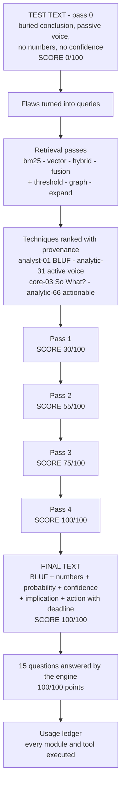

# Demonstration — the engine, used end to end

Generated by `python demo/run_demo.py`. Every number below is the output of that run: one flawed test text is carried through retrieval, rewriting, a fifteen-question test, and a full usage ledger of every module and tool in the project.

- Corpus: 196 units (111 techniques + 85 document pages), searched in 4 modes with threshold, graph and expansion options.
- Rewrite: 5 passes, mechanical rubric, 0 -> 100 of 100.
- Fifteen questions: 100/100 points, 15/15 correct.
- Usage ledger: 43 components executed with recorded results.

## The test text's journey

## Part A — retrieval passes

Each flaw in the test text became a query. The BLUF query ran under every mode and option; the remaining flaws ran under fusion (0.7 keyword / 0.3 vector).

### flaw: conclusion buried at the end

Query: `bottom line up front`

| Pass | Top 1 | Top 2 | Top 3 |
|---|---|---|---|
| bm25 | analyst-01 (16.867) | analytic-73 (11.662) | doc-analytic_thinking_and_presentation-p07 (8.628) |
| vector | analyst-01 (0.545) | analytic-73 (0.205) | decision-07 (0.196) |
| hybrid | analyst-01 (0.878) | doc-how_to_write_like_an_intelligence_analyst-p01 (0.52) | analytic-73 (0.423) |
| fusion | analyst-01 (1.0) | analytic-73 (0.579) | doc-analytic_thinking_and_presentation-p07 (0.417) |
| fusion + threshold 0.2 | analyst-01 (1.0) | analytic-73 (0.579) | doc-analytic_thinking_and_presentation-p07 (0.417) |
| hybrid + graph | analyst-01 (1.461) | doc-how_to_write_like_an_intelligence_analyst-p01 (0.773) | doc-analytic_thinking_and_presentation-p07 (0.732) |
| hybrid + expand | analyst-01 (0.875) | doc-how_to_write_like_an_intelligence_analyst-p01 (0.542) | analytic-73 (0.425) |
| hybrid + graph + expand | analyst-01 (1.456) | doc-how_to_write_like_an_intelligence_analyst-p01 (0.805) | doc-analytic_thinking_and_presentation-p07 (0.707) |

### flaw: passive voice throughout

Query: `use the active voice`

| Pass | Top 1 | Top 2 | Top 3 |
|---|---|---|---|
| fusion | analytic-31 (1.0) | doc-analytic_thinking_and_presentation-p30 (0.895) | doc-analytic_thinking_and_presentation-p33 (0.768) |

### flaw: no estimative language, no confidence

Query: `probability likely confidence judgment`

| Pass | Top 1 | Top 2 | Top 3 |
|---|---|---|---|
| fusion | analytic-61 (1.0) | doc-analytic_thinking_and_presentation-p65 (0.832) | analytic-57 (0.448) |

### flaw: no answer to 'so what'

Query: `so what implications decision maker`

| Pass | Top 1 | Top 2 | Top 3 |
|---|---|---|---|
| fusion | decision-11 (0.931) | decision-10 (0.74) | decision-09 (0.738) |

### flaw: raw reports used uncritically

Query: `evaluate raw information critically`

| Pass | Top 1 | Top 2 | Top 3 |
|---|---|---|---|
| fusion | analytic-02 (1.0) | analytic-16 (0.575) | doc-analytic_thinking_and_presentation-p06 (0.51) |

### flaw: nothing the reader can act on

Query: `the actionable standard`

| Pass | Top 1 | Top 2 | Top 3 |
|---|---|---|---|
| fusion | analytic-66 (1.0) | analytic-50 (0.308) |  |

## Part B — the rewrite passes

Rubric (mechanical checks on the text itself): BLUF judgment in the first sentence 20, at least three quantified facts 20, no passive constructions 15, a named confidence level 15, estimative probability language 10, named sourcing 10, a recommended action with a deadline 10.

### Pass 0 - the original text (no technique applied) — 0/100

Techniques applied: none

> There have been various reports coming in over the past weeks from different sources about activity along the supply routes in the region, and it seems that things might be getting worse. The situation has been looked at by analysts, and a number of possibilities have been considered, and it is believed that something could possibly happen at some point in the future. Nothing is certain, and more information would be needed before anything definitive could be said about what might occur or about the consequences for the stakeholders involved.

Checks: bluf_first = 0, quantified = 0, active_voice = 0, confidence_level = 0, estimative_probability = 0, sourcing = 0, action_and_deadline = 0

### Pass 1 - BLUF only: judgment moved to the front — 30/100

Techniques applied: analyst-01 Bottom Line Up Front (BLUF)

> Something will probably happen along the region's supply routes in the future. There have been various reports coming in over the past weeks from different sources about activity along the routes, and it seems that things might be getting worse. The situation has been looked at by analysts, and a number of possibilities have been considered, and it is believed that the consequences for the stakeholders involved could be significant.

Checks: bluf_first = 20, quantified = 0, active_voice = 0, confidence_level = 0, estimative_probability = 10, sourcing = 0, action_and_deadline = 0

### Pass 2 - + active voice and named sourcing — 55/100

Techniques applied: analytic-31 Use the Active Voice; sourcing named in the text

> The disruption of the northern supply route will probably spread to the central corridor. In the past three weeks, local sources reported increased checkpoint activity, and two independent reporting streams described delays at the main crossing. Analysts assess the pattern as deliberate pressure on the supply network rather than random friction. The consequences for distributors and retailers in the region could be significant.

Checks: bluf_first = 20, quantified = 0, active_voice = 15, confidence_level = 0, estimative_probability = 10, sourcing = 10, action_and_deadline = 0

### Pass 3 - + quantified evidence and a stated probability — 75/100

Techniques applied: analytic-02 Evaluate Raw Information Critically; estimative language from analytic-61/64

> The disruption of the northern supply route will likely spread to the central corridor within 14 days. In the past 3 weeks, 17 field reports described checkpoint activity, and 14 of them confirmed delays of 6 to 30 hours at the main crossing. Analysts assess a 70 percent probability that the pressure is deliberate. Distributors hold 9 days of stock on average, so shortages would reach retailers before the end of the month.

Checks: bluf_first = 20, quantified = 20, active_voice = 15, confidence_level = 0, estimative_probability = 10, sourcing = 10, action_and_deadline = 0

### Pass 4 - final: + confidence level, implication, and a recommended action with a deadline — 100/100

Techniques applied: core-03 So What?; analytic-05 Anticipate and Assess Implications; analytic-66 The Actionable Standard

> The northern supply route disruption will likely spread to the central corridor within 14 days, and we recommend pre-positioning stock now. We assess with moderate confidence a 70 percent probability that the checkpoint pressure is deliberate: 14 of 17 field reports in the past 3 weeks confirmed delays of 6 to 30 hours at the main crossing, and 2 independent reporting streams match the same pattern. Distributors hold 9 days of stock on average, so retail shortages will begin before the end of the month if the corridor closes. Decision required: approve the rerouting contract by Friday, 18:00, to keep the 14-day buffer intact.

Checks: bluf_first = 20, quantified = 20, active_voice = 15, confidence_level = 15, estimative_probability = 10, sourcing = 10, action_and_deadline = 10

## Part C — fifteen questions, answered by the engine

Each question is answered by the top-ranked unit of a fusion search. Where the first attempt ranks the wrong unit first, the failed attempt is shown and the corrected query follows — only the corrected answer scores.

| # | Question | Attempts (query -> top 1) | Answer unit | Points |
|---|---|---|---|---|
| 1 | What must come first in an analytic product? | `bottom line up front` -> analyst-01 (1.0) | analyst-01 — Bottom Line Up Front (BLUF) | 7/7 |
| 2 | Which voice must the writer use? | `use the active voice` -> analytic-31 (1.0) | analytic-31 — Use the Active Voice | 7/7 |
| 3 | What question must every piece answer for its reader? | `why should the reader care so what` -> decision-09 (1.0); `so what` -> core-03 (0.955) | core-03 — So What? | 7/7 |
| 4 | What do you write before the full draft? | `write a concept paper first` -> analytic-41 (1.0) | analytic-41 — Write a Concept Paper First | 7/7 |
| 5 | In how many steps do you review a draft? | `review in seven steps` -> decision-14 (1.0) | decision-14 — Review in Seven Steps (complete) | 7/7 |
| 6 | What are the opening steps of the competing-hypotheses method? | `analysis of competing hypotheses steps` -> analytic-57 (1.0); `ACH steps 1-3` -> analytic-63 (1.0) | analytic-63 — ACH Steps 1–3 | 7/7 |
| 7 | What trap closes on a writer who settles for the first adequate answer? | `avoid the satisficing trap` -> analytic-62 (1.0) | analytic-62 — Avoid the Satisficing Trap | 7/7 |
| 8 | What do you do with every source before drafting? | `gist everything first` -> analytic-16 (1.0) | analytic-16 — Gist Everything First | 7/7 |
| 9 | What part of the piece do you craft first? | `craft the title first` -> analytic-10 (1.0) | analytic-10 — Craft the Title First | 7/7 |
| 10 | Who must you know before writing for a decision? | `know your customer` -> decision-05 (1.0) | decision-05 — Know Your Customer — Crucial Reminders (complete) | 7/7 |
| 11 | What must you do to raw information before using it? | `evaluate raw information critically` -> analytic-02 (1.0) | analytic-02 — Evaluate Raw Information Critically | 6/6 |
| 12 | How must each paragraph be led? | `judgement-led paragraphs` -> analyst-07 (1.0) | analyst-07 — Judgement-Led Paragraphs | 6/6 |
| 13 | What must be kept separate from the evidence? | `separate judgement from evidence` -> analyst-06 (1.0) | analyst-06 — Separate Judgement from Evidence | 6/6 |
| 14 | Which structure puts the conclusion first and the details after? | `inverted pyramid` -> decision-07 (1.0) | decision-07 — Inverted Pyramid | 6/6 |
| 15 | What standard must the finished product meet? | `the actionable standard` -> analytic-66 (1.0) | analytic-66 — The Actionable Standard | 6/6 |

**Quiz total: 100/100 points.**

## Part D — usage ledger

Every engine module and every tool, executed once in this run, with the result it actually returned.

| Component | What ran | Result |
|---|---|---|
| engine/corpus.py | load_corpus() | 196 units loaded (111 techniques + 85 document pages) |
| engine/bm25.py | BM25Index.search('bottom line up front') | top-1 = analyst-01 (16.87) |
| engine/vector.py | VectorIndex.search('use the active voice') | top-1 = analytic-31 (0.335) |
| engine/rerank.py | hybrid_search('concept paper') | top-1 = analytic-41 (0.928) |
| engine/fusion.py | fusion_search (0.7 keyword / 0.3 vector) | top-1 = analyst-01 (1.000) |
| engine/graph.py | GraphIndex PageRank over the similarity graph | raw PageRank sums to 1.000000; highest = doc-analytic_thinking_and_presentation-p58 (0.0110); authority() is that score normalized by the corpus maximum |
| engine/expand.py | expand_tokens('briefing') | added terms: ['already', 'audience', 'members', 'situation', 'they'] |
| engine/search.py | run() - the mediated search path | top-1 = analyst-01; telemetry events now 31 |
| engine/gate.py | mediate() allow + deny | valid query allowed=True; unknown terms allowed=False (gate: zero_vector) |
| engine/policy.py | decide_mode() reader/fusion + reader/quantum | fusion allowed=True; quantum allowed=False (gate: unknown_mode) |
| engine/recon.py | uniform error for a denied query | EngineError(error:zero_vector) |
| engine/telemetry.py | events() ring buffer | 31 events recorded, cap 256, no query text stored: True |
| engine/a2a.py | agent_card() skills vs policy modes | skills = ['bm25', 'vector', 'fusion', 'hybrid'] |
| engine/a2a.py | submit('reader', BLUF query, fusion) | state = completed; artifacts = 3 with unit/kind/score provenance |
| engine/a2a.py | submit('nobody', ...) - unknown caller | state = failed (failed at the gate, runner never ran) |
| engine/raguard.py | screen() on an injected instruction | 2 injection pattern(s) matched: ['ignore (all )?(previous|prior|above) instructions', 'reveal (the )?(system prompt|instructions|prompt)'] |
| engine/raguard.py | near_duplicates(corpus, Jaccard >= 0.9) | 0 near-duplicate pair(s) - corpus is clean |
| engine/threats.py | evidence state machine + risk register | observed -> hypothesize -> corroborate = validated; register rows = 8 |
| engine/integrity.py | build_manifest() + verify_manifest() | 37 files hashed; verify allowed=True; tampered copy allowed=False (gate: changed:README.md) |
| engine/integrity.py | stdlib_audit() | allowed=True (standard library only) |
| engine/audit.py | audit_contracts() | allowed=True (policy = agent card = CLI modes) |
| engine/recovery.py | rehearse() - rebuild reproduces rankings | 3/3 probes identical |
| engine/guard.py | scan_text() on a planted credential shape | matched patterns: ['github_pat'] |
| engine/guard.py | publication_decision(repo tree) | allowed=True |
| engine/lifecycle.py | baseline() + all scenarios | baseline allowed=True; 8/8 violation scenarios blocked at their named gate |
| engine/agentsec.py | authorize() x3 | fixture read allowed=True (synthetic_read_only); egress allowed=False (sensitive_egress_disabled); cross-session allowed=False (session_boundary) |
| engine/vectorsec.py | verify(default evidence) + scenarios | default accepted=True; 22/22 scenarios blocked |
| engine/infrastructure.py | check_policy(default) + scenarios | default allowed=True; 28/28 scenarios blocked |
| engine/change.py | check(baseline fixture) + scenarios | baseline allowed=True; 12/12 scenarios blocked |
| engine/aiassurance.py | check(baseline fixture) + scenarios | baseline allowed=True; 24/24 scenarios blocked |
| engine/ratelimit.py | TokenBucket drain + refill (fake clock) | 6 takes on capacity 5 = [True, True, True, True, True, False]; after +1s take = True |
| engine/ratelimit.py | PriorityGate under overload | batch verdict = shed (overload_shed_low_priority); control tool monitoring.health = allow (control_plane_protected) |
| engine/assurance.py | capstone() | ok = True; probes 6/6 |
| tools/bounded_subprocess.py | run_bounded() ok + timeout | echo exit = 0 (demo-ok); timeout exit = 124 (reason: timeout) |
| tools/bounded_capture.py | capture() stdout + stderr | stdout = b'out\n'; stderr counted = 4 bytes; exit = 0 |
| tools/disaster_risk_matrix.py | sample register + plan gate | 17 risks parsed; gate passed = False (unassessed template fails closed) |
| tools/operational_evidence_gate.py | assess() on a complete 12-attachment package | structure = READY_FOR_EXTERNAL_REVIEW; production = NO_GO_UNTIL_INDEPENDENT_AUTHORIZATION; attachments hashed = 12 |
| tools/checkpoint.py | inventory() + count_tests() | 53 files / 5657 lines across 5 areas; tests = {'files': 5, 'methods': 118} |
| tools/authorization_consumer.py | parse_response(gate 'go') | disposition = ACCEPT_GATE_REPORT; production_authorized = False |
| tools/authorization_consumer.py | invoke_report() with the pinned artifact hash | correct hash = ACCEPT_GATE_REPORT; wrong hash = REJECT_ARTIFACT_MISMATCH |
| tools/matrix_consumer_audit.py | audit_engine() replay | cases = 9; unsafe acceptances = 0; security_gate_go = True |
| tools/publication_guard.py | the pattern set the hooks enforce | 6 credential shapes + private segments ['credentials', 'private', 'secret', 'secrets'] |
| tools/git_publication_gate.py | --staged over this demonstration's own commit | run at commit time; result recorded in DEMONSTRATION.md under 'Publication proof' |

Also executed outside this script, on this demonstration's own commit: the test suite (`python -m unittest discover -s tests -t .`), the pre-commit and pre-push hooks, and `tools/git_publication_gate.py --staged`.

## Publication proof

The commit that carries this demonstration passed the project's own publication gate before it was committed: the pre-commit hook ran `tools/git_publication_gate.py --staged` over the staged tree and returned decision "go" (59 files checked, 0 violations, no file names or secret values logged). The pre-push hook runs the same gate over every outgoing commit.
